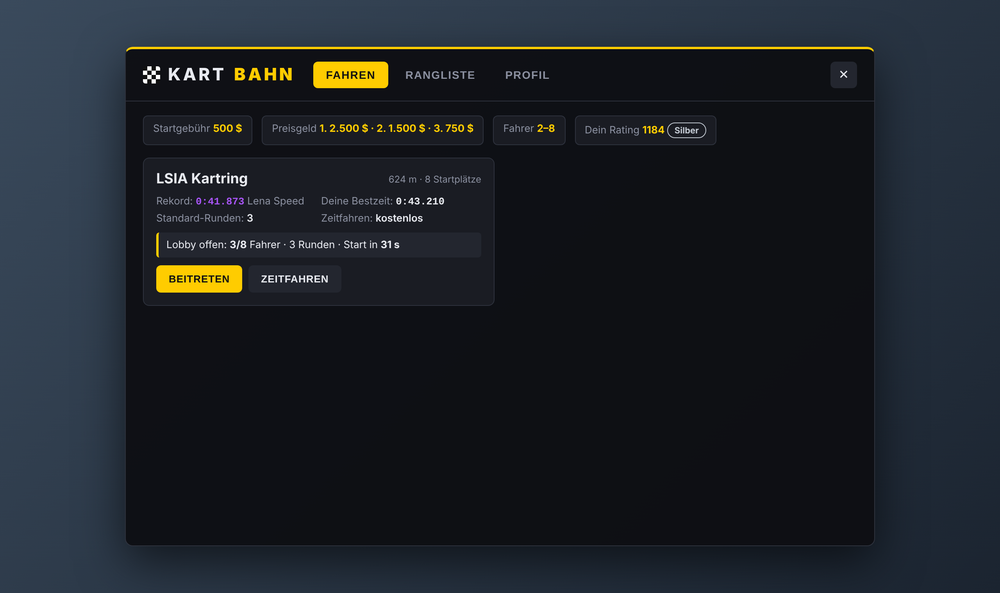
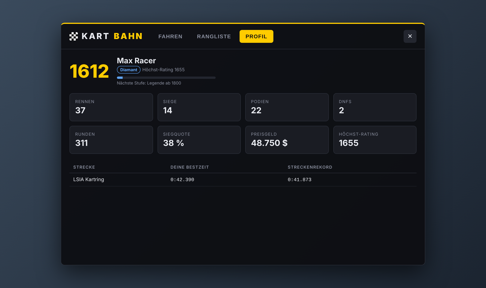
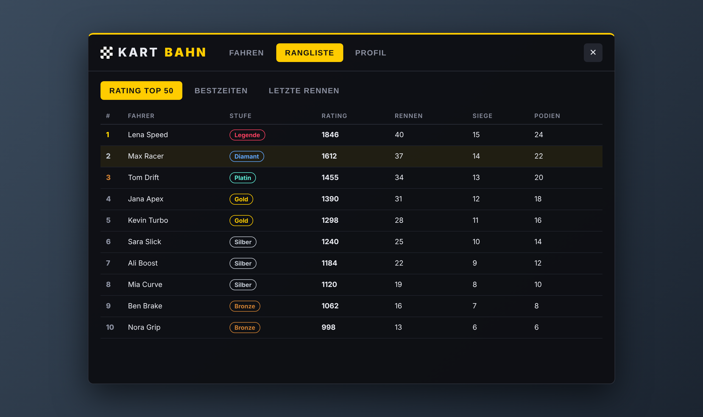
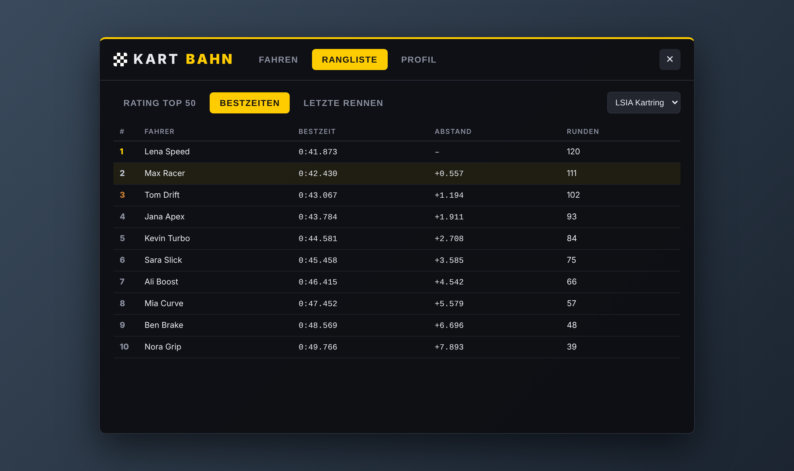
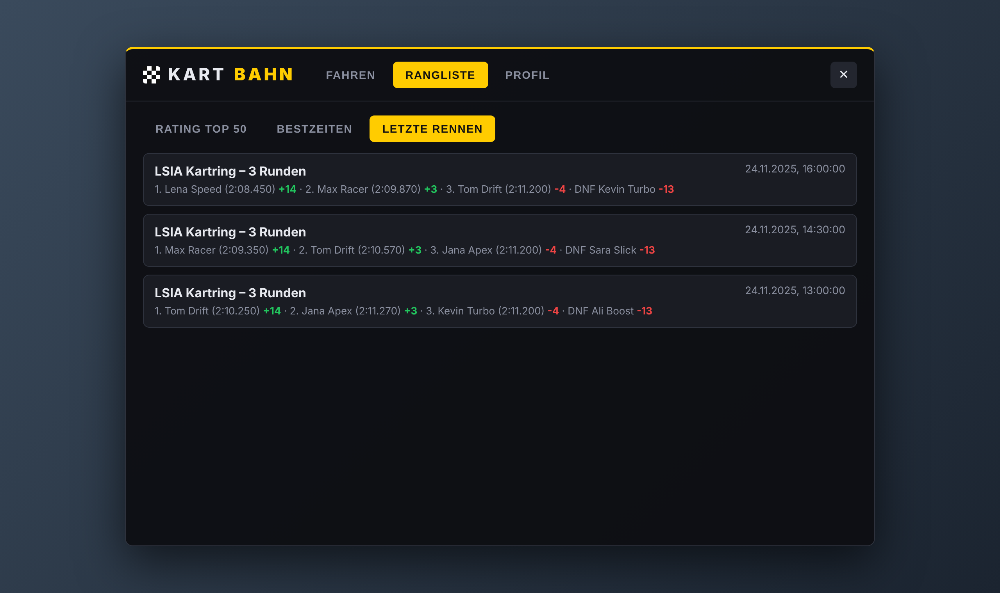
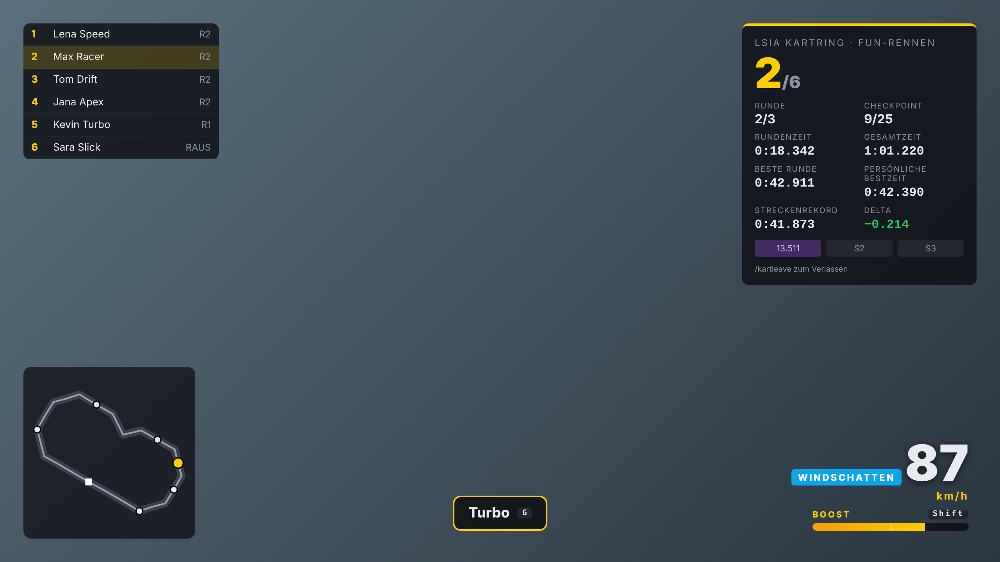
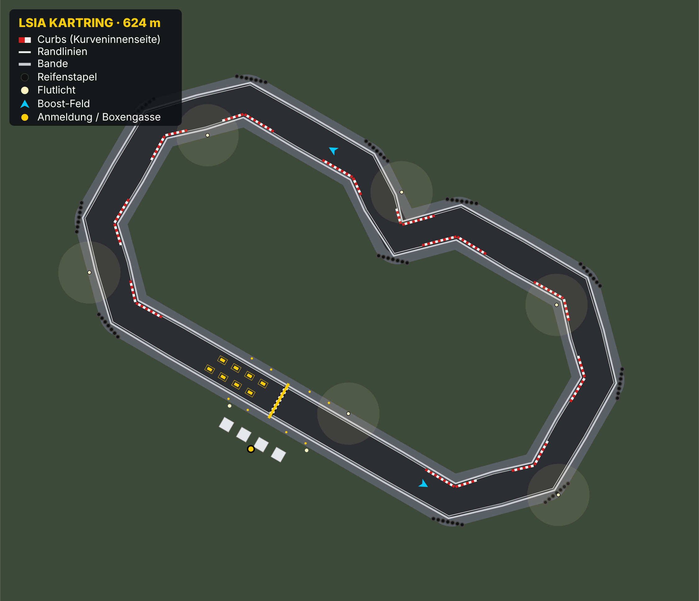

# kartbahn – Kartbahn für FiveM (Standalone / ESX / QBCore)

Rennen mit Lobby, Zeitfahren, Elo-Ranking mit Stufen, Bestzeiten, serverseitiges Anti-Cheat,
automatische Streckenbegrenzung und In-Game-Strecken-Editor. NUI ohne externe Libraries.

## Voraussetzungen
- FiveM-Server mit **OneSync** (Lua 5.4, `fx_version cerulean`)
- [oxmysql](https://github.com/overextended/oxmysql)
- Optional: `es_extended` **oder** `qb-core` (wird automatisch erkannt; ohne Framework ist alles kostenlos)

## Installation
1. Ordner `kartbahn` nach `resources/` kopieren.
2. SQL aus `sql/kartbahn.sql` importieren (die Tabellen werden beim Start zusätzlich automatisch angelegt).
3. In der `server.cfg` (nach oxmysql und ggf. dem Framework):
   ```cfg
   ensure oxmysql
   # ensure es_extended   oder   ensure qb-core
   ensure kartbahn

   # Editor-Rechte
   add_ace group.admin kart.admin allow
   # oder für einen einzelnen Spieler:
   # add_principal identifier.license:DEINE_LICENSE group.admin
   ```
4. Server starten. Der Blip „Kartbahn“ erscheint am LSIA-Vorfeld. Mit **E** am Marker öffnet sich das Menü.

> Der Server muss Schreibrechte auf `data/tracks/` haben, damit der Editor Strecken speichern kann.

## Spielmodi
- **Rennen**: Lobby mit Countdown (Standard 45 s, bei voller Lobby 5 s), 2–8 Fahrer. Wer die Lobby eröffnet,
  wählt die Rundenzahl. Startgebühr wird beim Beitritt abgezogen und bei Absage erstattet.
  Preisgeld für Platz 1–3. Startaufstellung nach Rating – die Besten starten hinten.
  Wer das Kart länger als 10 s verlässt, bekommt ein DNF. Rennende, wenn alle im Ziel sind oder 60 s nach dem ersten Zieleinlauf.
- **Zeitfahren**: allein, unbegrenzt viele Runden; jede gültige Runde zählt für die Bestzeiten.
  Verlassen mit `/kartleave` oder durch Aussteigen (> 10 s).

## Ranking
- Elo für mehrere Fahrer (jeder gegen jeden, K = 32, Start 1000; DNFs teilen sich den letzten Platz)
- Stufen: Bronze, Silber, Gold, Platin, Diamant, Legende (Grenzen und Farben in `config.lua`)
- Rangliste Top 50, Bestzeiten je Strecke, letzte 10 Rennen, Profil mit Statistik
- Neuer Streckenrekord wird allen Spielern angezeigt

## Anti-Cheat (serverseitig)
- Checkpoints nur in der richtigen Reihenfolge
- Positionsprüfung mit `GetEntityCoords` auf dem Server (halbe CP-Breite + Toleranz)
- Mindestabstand zwischen Checkpoints, Mindestrundenzeit (`minLap` pro Strecke)
- Rundenzeiten werden ausschließlich vom Server gemessen
- Bei ungültiger Meldung schickt der Server dem Client den korrekten Stand (`kartbahn:sync`)
- Kart-Kontrolle serverseitig (`GetVehiclePedIsIn`); Runde wird ungültig, wenn das Kart verlassen wurde

## Befehle
| Befehl | Beschreibung |
|---|---|
| `/kartleave` | Rennen/Zeitfahren/Lobby verlassen (im Rennen = DNF) |
| `/kartedit [id]` | Editor starten (mit `id` wird eine vorhandene Strecke geladen) – benötigt `kart.admin` |
| `/kartcp [breite]` | Checkpoint an der eigenen Position (Standard 12 m). **CP 1 = Start/Ziel** |
| `/kartgrid` | Startplatz an Position + Blickrichtung (bzw. Fahrzeug), max. 8. Platz 1 = Pole |
| `/kartprop <model>` | Prop 3 m vor dir setzen |
| `/kartundo` | Letzte Aktion rückgängig |
| `/kartlaps <n>` | Standard-Rundenzahl |
| `/kartbarriers` | Automatische Begrenzung an/aus |
| `/kartsave <id> [Anzeigename]` | Strecke speichern (`data/tracks/<id>.json`) |
| `/kartcancel` | Editor ohne Speichern beenden |

### Strecke bauen
1. `/kartedit meinestrecke`
2. Den Kurs abfahren und alle 20–40 m `/kartcp` setzen. Der erste Checkpoint ist die Start-/Ziellinie.
3. Startplätze **hinter** CP 1 in Fahrtrichtung mit `/kartgrid` setzen (Pole zuerst).
4. `/kartsave meinestrecke Meine Strecke`

Die Vorschau zeigt Checkpoints (gelb, Start weiß), Ideallinie, Begrenzungskanten (rot), Startplätze (blau)
und die echten Absperrungen.

## Streckenformat (`data/tracks/<id>.json`)
```json
{
  "id": "lsia", "name": "LSIA Kartring", "laps": 3, "minLap": 25000, "autoBarriers": true,
  "checkpoints": [ { "x": 0.0, "y": 0.0, "z": 0.0, "w": 14.0 } ],
  "grid":        [ { "x": 0.0, "y": 0.0, "z": 0.0, "h": 0.0 } ],
  "props":       [ { "model": "prop_flag_ls", "x": 0.0, "y": 0.0, "z": 0.0, "h": 0.0 } ]
}
```
Alle geladenen Strecken stehen in `data/tracks/_index.json` (pflegt der Editor automatisch).
Die Standardstrecke `lsia` ist ein ca. 620 m langer, geschlossener Rundkurs mit 25 Checkpoints und 8 Startplätzen
auf dem LSIA-Vorfeld. Falls auf deinem Server dort Mapping steht, einfach mit dem Editor neu aufnehmen.

## Performance & Aufräumen
- Leerlauf: Menü-Schleife 1×/s, Prop-Streaming alle 2 s → ~0.00 ms resmon
- Absperrungen/Pylonen/Props werden **lokal** und nur in der Nähe (350 m) gespawnt
- Karts werden serverseitig erstellt und bei Rennende, Spieler-Disconnect und Resource-Stop gelöscht;
  lokale Props, Blips und Editor-Objekte werden beim Resource-Stop entfernt

## Konfiguration
Alles in `config.lua`: Framework, Menüpunkte, Kart-Modelle, Lobby-Zeiten, Spielerzahl, Runden, Startgebühr,
Preisgelder, DNF-Zeit, Elo (K, Startwert), Stufen, Anti-Cheat-Toleranzen, Absperrungs-Modelle/Abstände,
Editor-Grenzen, Ranglisten-Größen und alle Texte.

## Feste Kartbahn „LSIA Kartring“
Die Standardstrecke ist komplett ausgebaut (alles lokal gespawnt, für jeden Spieler in der Nähe sichtbar):
- durchgehende Betonbande links und rechts (`barrierModel`/`barrierSpacing` pro Strecke einstellbar)
- Reifenstapel auf der Außenseite jeder Kurve, Pylonen an allen Checkpoints
- Startportal über Start/Ziel, Fahnen an der Start-Geraden
- Boxengasse mit Zelten und Flutlicht neben dem Anmeldepunkt

Modelle, die es in deiner Spielversion nicht gibt, werden automatisch übersprungen.

## Vorschau






## Eigenes Kart „KB-1“
Basis ist das Modell `veto2`, die Fahrphysik ist komplett eigen:
- **`data/meta/handling.meta`**: wird als Mod-Datei (`data_file 'HANDLING_FILE'`) beim Verbinden an alle Spieler geladen.
- **`Config.Kart` in `config.lua`**: dieselben Werte setzt das Skript beim Spawn zusätzlich direkt aufs Kart.
  Das ist die Absicherung, falls die Meta nicht greift. Zum Feintuning reicht es, die `config.lua` zu ändern.
- Höchstgeschwindigkeit (Standard 95 km/h), Racing-Gelb/Schwarz, Kennzeichen mit Startnummer („KB-1“ … „KB-8“).
- Leichter (230 kg), tiefer Schwerpunkt, viel Grip, wenig Schaden – fährt wie ein echtes Leihkart.

Wichtig: Die `handling.meta` ändert das Handling **aller** `veto2` auf dem Server.
Wer das nicht möchte, entfernt die Zeile `data_file` im `fxmanifest.lua`; die Werte aus der Config gelten trotzdem.

## Features (alle in `config.lua` einstellbar)
| # | Feature | Kurz |
|---|---|---|
| 1 | **Boost-Knopf** | `Shift`: 2,5 s mehr Schub. Ladung wird **serverseitig** geführt und lädt sich auf |
| 2 | **Windschatten** | Dicht hinter einem Gegner: mehr Leistung + Boost-Ladung (Server prüft die Positionen) |
| 3 | **Perfekter Start** | Gas genau bei GO = Startboost, Gas in der letzten Countdown-Sekunde = Frühstart-Strafe |
| 4 | **Drift-Boost** | Lange Drifts geben danach einen kurzen Schub (nur in Modi mit Boost) |
| 5 | **Boost-Felder** | Blaue Pfeile auf der Strecke, im Editor mit `/kartboost` |
| 6 | **Item-Modus** | Item-Boxen (Turbo, Ölpfütze, Schutzschild), `G` zum Benutzen; hinten gibt's bessere Items |
| 7 | **Ghost** | Im Zeitfahren gegen die eigene Bestzeit oder den Streckenrekord fahren |
| 8 | **Ausscheidung** | Nach jeder Runde fliegt der Letzte raus (Runden = Fahrer − 1) |
| 9 | **Teamrennen** | Rot gegen Blau, Punkte nach Platz, Bonus für das Siegerteam |
| 10 | **Meisterschaft** | Wochenwertung aus Ranked-Rennen, Preisgeld für die Top 3 (Auszahlung beim nächsten Menü-Öffnen) |
| 11 | **Sektorzeiten** | 3 Sektoren, Live-Delta zur persönlichen Bestzeit (lila/grün/gelb) |
| 12 | **Minimap** | Streckenumriss mit allen Fahrern im HUD |
| 13 | **Zuschauen** | Laufende Rennen im Menü ansehen, `←`/`→` Fahrer wechseln, `Backspace` beenden |
| 14 | **Siegerpodest** | Top 3 auf dem Podest mit Konfetti und Kamerafahrt (Editor: `/kartpodium`) |
| 15 | **Startampel** | Rote Lichter über der Startlinie, grün bei GO |
| 16 | **Kart-Design** | Lackierung und Startnummer im Profil; besondere Farben ab bestimmter Stufe |
| 17 | **Erfolge** | 12 Abzeichen im Profil |
| 18 | **Wetten** | Zuschauer setzen in der Lobby auf einen Fahrer (Totalisator, nur mit ESX/QBCore) |

**Renn-Modi** (wählt, wer die Lobby eröffnet): *Ranked* (zählt für Rating und Meisterschaft, ohne Boost/Items),
*Fun-Rennen* (Boost + Items, ohne Rating), *Ausscheidung*, *Teamrennen*. Zeitfahren läuft ohne Boost, damit Bestzeiten fair bleiben.

Zusätzliche Editor-Befehle: `/kartboost`, `/kartitem`, `/kartpodium`.



## Fahrverhalten (Presets)
In `config.lua` → `Config.Kart.Preset`:
- `leihkart` – ruhig, 80 km/h, für Einsteiger
- `sport` – **Standard**, 100 km/h, viel Grip, direkte Lenkung, sehr tiefer Schwerpunkt
- `drift` – Heck kommt leicht, größerer Lenkeinschlag

Alle Werte stehen in `Config.KartPresets` und können frei angepasst werden. `data/meta/handling.meta` entspricht dem Preset `sport`.

## Angehobene Strecke
Die Strecke „LSIA Kartring“ liegt 3 m über dem Boden auf einer durchgehenden Fahrbahn aus gleichen Asphalt-Platten
(Modell aus `Config.Platform.Models`, Größe wird im Spiel automatisch gemessen) – dadurch überall gleicher Grip.
- Wer runterfällt, wird automatisch auf den letzten Checkpoint zurückgesetzt (Runde ungültig), manuell mit `/kartreset`
- Im Editor: `/kartplatform [höhe]` schaltet die angehobene Fahrbahn für eine Strecke an/aus

## Optik
- **Fahrbahn-Markierungen** werden direkt auf den Asphalt gezeichnet (keine Objekte): weiße Randlinien,
  rot-weiße Curbs an jeder Kurveninnenseite, karierte Start-/Ziellinie und gelbe Startboxen.
  Werden automatisch aus den Checkpoints berechnet – gilt also auch für jede Editor-Strecke (`Config.Paint`).
- **Flutlicht** an jedem 4. Checkpoint, das nachts (20–6 Uhr) die Strecke wirklich ausleuchtet (`Config.Lights`).


